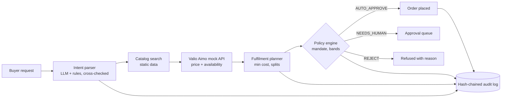

# Trusted Trade Agents (Junction 2026, Valio Aimo)

A buyer's purchasing agent that finds products, compares live prices and availability from Valio Aimo,
and places an order within a signed mandate. Anything outside the mandate goes to a human or is refused.

**The LLM interprets, code enforces.** The LLM only parses the request. Every permission decision comes
from a deterministic, unit-tested policy engine.

## Setup and run

```bash
python -m venv .venv
.venv/Scripts/python -m pip install -r requirements.txt     # Linux/macOS: .venv/bin/python
cp .env.example .env                                         # then fill in VALIO_API_KEY
.venv/Scripts/python -m app.cli "I need 1,000 litres of lactose-free milk by Monday."
```

Options: `--mandate hotel|school`, `--no-llm` (rule-based parser only).
Tests: `.venv/Scripts/python -m pytest -q`

## How it works



| Module | Role |
|---|---|
| `app/valio_client.py` | Typed client for the mock price and availability API |
| `app/catalog.py` | Static search, then live enrichment of the shortlist |
| `app/intent.py`, `app/llm.py` | Request to `IntentSpec`; swappable LLM provider with rule-based fallback |
| `app/planner.py` | Covers the quantity by the deadline at minimum cost |
| `app/policy.py`, `app/mandates.py` | Deterministic policy rules and buyer mandates |
| `app/signing.py`, `app/audit.py` | Ed25519 signing and the append-only hash-chained audit log |
| `app/agent.py`, `app/cli.py` | Orchestration and the one-command entry point |

## Status

- **M1 done:** request to auto-placed order from one command, against the live mock API.
- Next: approval queue and UI (M2), exceptions (M3), signed offers (M4), receipts in the UI (M5).

See `docs/api-notes.md` for the API and `ASSUMPTIONS.md` for what is mocked (notably: ordering).
