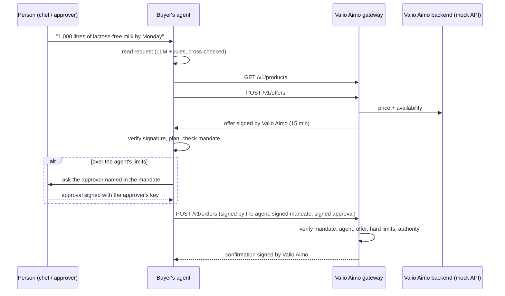

# Trusted Trade Agents (Junction 2026, Valio Aimo)

How a food-service wholesaler can let outside purchasing agents order safely. There are two separate services:

- **Valio Aimo's agent gateway** (`gateway/`): the open interface any buyer's agent uses to search the catalog,
  get a **signed offer** (fixed prices, 15 minutes), and place an order. Valio Aimo does not trust the agent: it
  checks the buyer's signed mandate, the agent's signature, the hard limits and, above the agent's limits, a
  person's signed approval, before it confirms with a signed confirmation. REST with OpenAPI docs, plus MCP.
- **A buyer's purchasing agent and console** (`app/`): a hotel and a school kitchen. The agent reads a request,
  works with the gateway over HTTP only, plans the cheapest option that meets the requirements, and orders it
  within its mandate, asks the named approver, or refuses. The console shows every message between the two
  sides as it happens.

**The LLM interprets, code enforces.** The LLM only reads the request. Every permission decision comes from a
deterministic, tested policy engine on the buyer's side and from fixed checks again on Valio Aimo's side.

## Run

```bash
python -m venv .venv
.venv/Scripts/python -m pip install -r requirements.txt     # Linux/macOS: .venv/bin/python
cp .env.example .env                                         # then fill in VALIO_API_KEY
.venv/Scripts/python -m scripts.dev                          # gateway on :8100, console on :8000
```

Open http://127.0.0.1:8000. You are signed in as Aino (head chef, hotel). Send a request and watch the agent
work with Valio Aimo. For approvals, switch to Mikko (purchasing manager) in the sidebar; Sari runs the school
kitchen, whose mandate forbids nuts. Valio Aimo's API docs are at http://127.0.0.1:8100/docs.

- One request from the terminal (gateway running): `.venv/Scripts/python -m app.cli --buyer school "..."`
- MCP (gateway running): `.venv/Scripts/python -m gateway.mcp_server`; config snippet in `gateway/mcp_server.py`
- `LLM_PROVIDER=none` in `.env` skips the LLM (faster; rule-based parser only)
- Tests: `.venv/Scripts/python -m pytest -q`

Keys are created on first run under `keys/` (git-ignored): `keys/gateway/` is Valio Aimo's private key,
`keys/buyer/` the buyers' organisation, agent and approver keys plus their signed mandates, `keys/registry/`
the buyer public keys Valio Aimo trusts.

## How it works



| Where | What |
|---|---|
| `protocol/` | What both sides agree on: wire formats (`wire.py`), the mandate, Ed25519 signing over canonical JSON |
| `gateway/service.py`, `gateway/api.py` | Valio Aimo's offers, order checks and confirmations; HTTP interface |
| `gateway/catalog.py`, `gateway/backend.py` | Catalog search; the challenge's price and availability API |
| `gateway/mcp_server.py` | The same interface as MCP tools |
| `app/agent.py` | The buyer's agent: request to order, approval or refusal |
| `app/intent.py`, `app/planner.py`, `app/policy.py` | Reading requests, planning at minimum cost, the mandate rules |
| `app/keys.py`, `app/mandates.py` | Buyer keys, people and signed mandates |
| `app/timeline.py`, `app/web.py` | The step-by-step story and the console |
| `app/audit.py` | Append-only, hash-chained audit log |

## Status

- **M1, M2:** request to order, signed mandates, full policy engine, approval queue, console.
- **Hardening:** safe under concurrent requests and approvals; changed circumstances at sign-off go back to the
  approver; stricter request parsing and LLM cross-checks.
- **Two-sided split:** separate Valio Aimo gateway (REST + MCP) with signed offers and confirmations; real,
  separate keys; Valio Aimo enforces the mandate itself; live split-screen console; people and roles.
- Next: simulated kitchen stock that triggers orders by itself, order delivery lifecycle, wording pass.

See `docs/api-notes.md` for the challenge's mock API and `ASSUMPTIONS.md` for what is simulated.
